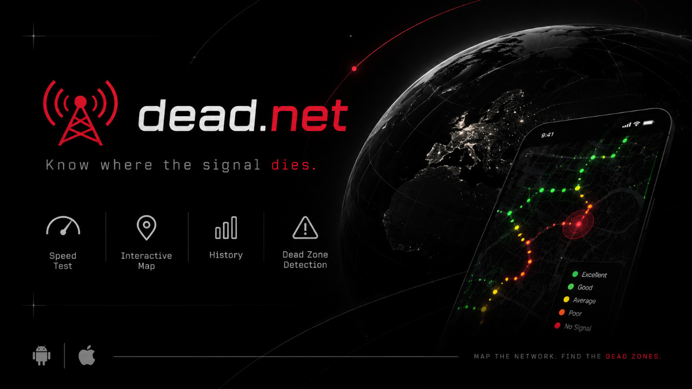
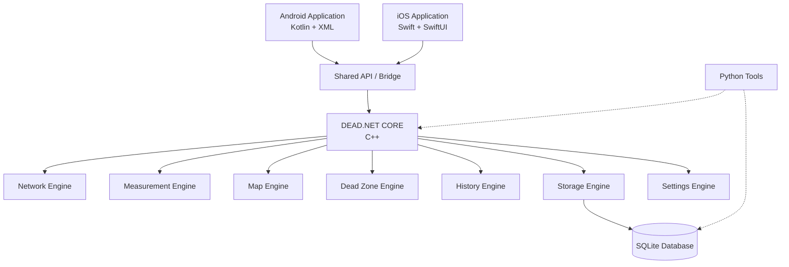

<h3 align="center">Know where the signal dies.</h3>

  

  <i>Map the network. Find the dead zones.</i>

---

## 🌐 About

**dead.net** is a cross-platform network monitoring and mapping platform designed to visualize real-world internet connectivity.

It continuously collects network measurements, associates them with geographic coordinates, and transforms raw connection data into an interactive map of network quality.

The goal is simple: understand not only how fast your internet is, but also **where your connection works, where it struggles, and where the signal disappears.**

Unlike traditional speed-testing applications, dead.net focuses on the geographical and historical aspect of connectivity.

## Core Features

- 📶 **Network Monitoring** — Periodically measure network quality and connection status.
- 🚀 **Speed Testing** — Measure Download, Upload, Ping, Jitter and Packet Loss.
- 🗺️ **Interactive Maps** — Visualize connection quality through geographically distributed measurements.
- 📍 **Location Tracking** — Associate measurements with geographic coordinates.
- 🔴 **Dead Zone Detection** — Identify areas with repeatedly confirmed connectivity problems.
- 📅 **Daily Map History** — Keep detailed maps of the last seven days.
- 🗃️ **Historical Aggregation** — Combine older measurements into a unified local map.
- ⚙️ **Background Monitoring** — Collect measurements at configurable time intervals, subject to operating system restrictions.
- 💾 **Local-First Storage** — Keep measurements, settings and history directly on the device.

## Network Quality

Each measurement is represented by a color indicating the observed connection quality.

| Color | Connection Quality |
|:---:|---|
| 🟢 | Excellent |
| 🟡 | Average |
| 🟠 | Poor |
| 🔴 | Very Poor |
| ⬛ | No Connection |

Repeated measurements help distinguish persistent dead zones from temporary connection failures.

## Architecture

dead.net is designed around a shared computational core and two independent native mobile applications.

The interface, network measurements, geographic analysis and data storage are separated into independent components.

### Core Technologies

| Component | Technology | Responsibility |
|---|---|---|
| Shared Core | C++ | Main application logic and computation |
| Android | Kotlin + XML | Native Android interface and system integration |
| iOS | Swift + SwiftUI | Native iOS interface and system integration |
| Android Bridge | JNI | Kotlin-to-C++ communication |
| iOS Bridge | Objective-C++ | Swift-to-C++ communication |
| Local Database | SQLite | Measurements, history and settings |
| Development Tools | Python | Data analysis, experiments and testing |
| Build System | CMake | Cross-platform C++ core configuration |

### Native Maps

Each platform uses its native mapping solution:

- **Android:** Google Maps SDK.
- **iOS:** Apple MapKit.

The shared C++ core handles geographic data and map-related logic independently of the platform-specific rendering SDKs.

### Core Modules

- **Network Engine** — Network connectivity and performance measurements.
- **Measurement Engine** — Processing and validation of measurement results.
- **Map Engine** — Geographic points and spatial data.
- **Dead Zone Engine** — Detection and updating of areas with poor or unavailable connectivity.
- **History Engine** — Daily sessions, historical maps and aggregation.
- **Storage Engine** — Local SQLite database operations.
- **Settings Engine** — Monitoring configuration and application preferences.

## Local-First Design

The first version of dead.net is designed to operate entirely on the user's device.

There is no account system, registration, cloud synchronization or shared community database in the initial release.

All measurements and application data are stored locally using SQLite.

### History System

The application maintains:

- **7 daily maps** — Detailed measurements from the latest seven days.
- **1 aggregated map** — A unified representation of older measurements.

As measurements become older than the seven-day history window, they are spatially aggregated to avoid unnecessary duplication and excessive map density.

## Python & Future Expansion

Python is used as a supporting development environment rather than a runtime backend inside the mobile applications.

Its responsibilities include:

- Measurement data analysis.
- Algorithm experiments.
- Test data generation.
- Visualization and validation of results.

The architecture also leaves room for future server-side expansion.

Potential future technologies:

- FastAPI — Server-side backend.
- PostgreSQL + PostGIS — Centralized geographic data storage.
- Community coverage — Shared network quality maps.

**These features are not part of the initial local-only release.**

## Platforms

| Platform | Interface | Mapping |
|---|---|---|
| Android | Kotlin + XML | Google Maps |
| iOS | Swift + SwiftUI | Apple MapKit |

Both applications use the same C++ core while retaining their own native interfaces and platform-specific integrations.

## Project Status

**Currently in development.**

dead.net is an evolving engineering project. Its architecture and initial functionality are being developed incrementally.

The repository structure is designed to support long-term development, modularity and future expansion.

---

  <strong>dead.net</strong>
   
  <i>Know where the signal dies.</i>
    
  Built to map the invisible.

